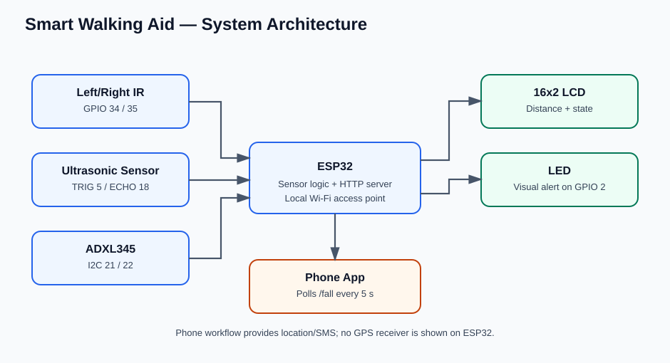
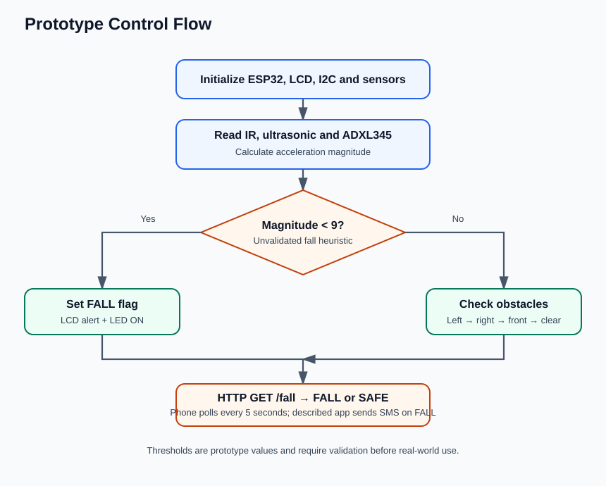
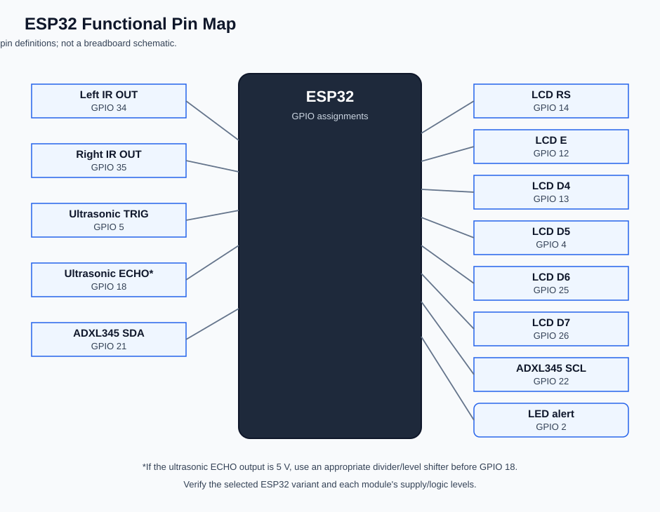

# Smart Walking Aid with Obstacle Detection

**Repository description:** ESP32-based smart walking aid prototype with IR and ultrasonic obstacle detection, ADXL345 motion monitoring, LCD/LED alerts, and a local phone-app emergency workflow.

**Project author: Rohith K A**

An ESP32-based academic prototype described in the supplied project material. It combines left/right IR obstacle sensing, front ultrasonic distance measurement, an ADXL345 acceleration heuristic, a 16×2 LCD, an LED alert, and a local Wi-Fi/HTTP link to a phone app. The described MIT App Inventor workflow polls \`GET /fall\` every 5 seconds and sends an SMS with phone location when a \`FALL\` response is received.

> **Prototype only:** this project is not a certified mobility aid or a validated fall-detection system. Do not rely on it as a replacement for established mobility aids. Read [the limitations and safety notes](docs/limitations_and_safety.md) before building or testing.

## Features represented by the supplied code/slides

- Left and right obstacle indications from digital IR sensors.
- Front distance from an ultrasonic sensor; prototype obstacle threshold is 30 cm.
- ADXL345 acceleration magnitude heuristic to flag a possible fall.
- 16×2 LCD status messages and LED indicator.
- ESP32 hotspot named \`SmartStickESP\` and HTTP endpoint \`http://192.168.4.1/fall\`.
- Phone-app design for polling, displaying the alert, and sending one SMS per continuous FALL state with phone latitude/longitude.

## Important implementation gap

The stated aim mentions directional vibration feedback, but the supplied code does not define vibration hardware or control logic. This package documents that feature as **not implemented in the supplied firmware** rather than claiming it works. The slides also do not show a GPS receiver attached to the cane; location in the described emergency SMS comes from the phone app.

## Repository structure

\`\`\`text
smart-walking-aid/
├── README.md
├── src/
│   └── smart_walking_aid.ino
├── assets/
│   ├── system_architecture.svg
│   ├── system_flow.svg
│   └── pin_map.svg
└── docs/
    ├── Smart_Walking_Aid_Project_Report.docx
    ├── hardware_and_wiring.md
    ├── component_list_and_bom.md
    ├── mit_app_inventor_setup.md
    ├── system_logic.md
    ├── testing_validation.md
    └── limitations_and_safety.md
\`\`\`

## System architecture

## System flow

## Hardware pin map

## Hardware pin summary

| Function | ESP32 pin |
|---|---:|
| Left IR digital output | GPIO 34 |
| Right IR digital output | GPIO 35 |
| Ultrasonic TRIG | GPIO 5 |
| Ultrasonic ECHO | GPIO 18 |
| LED alert | GPIO 2 |
| ADXL345 SDA / SCL | GPIO 21 / 22 |
| LCD RS, E, D4, D5, D6, D7 | 14, 12, 13, 4, 25, 26 |

See [hardware and wiring](docs/hardware_and_wiring.md) for the full table and electrical checks.

## Firmware setup

1. Open \`src/smart_walking_aid.ino\` in Arduino IDE.
2. Select an ESP32 board that matches the hardware and select its serial port.
3. Install the \`Adafruit Unified Sensor\` and \`Adafruit ADXL345\` libraries if not already installed; \`WiFi\` and \`Wire\` are supplied by the ESP32 Arduino core. Ensure a compatible \`LiquidCrystal\` library is available.
4. Confirm all pins and sensor voltage requirements before powering the circuit. Many ultrasonic sensor ECHO outputs require level shifting before connecting to an ESP32 input.
5. Change the demonstration Wi-Fi password in the sketch before use outside a controlled bench setup.
6. Upload and open Serial Monitor at 115200 baud. Confirm the ADXL345 initializes and note the printed access-point IP.
7. Connect the phone to the ESP32 access point and configure the MIT App Inventor app according to [the app guide](docs/mit_app_inventor_setup.md).

## App protocol

The firmware serves a plain-text response at \`/fall\`:

- \`FALL\`: acceleration magnitude has crossed the prototype threshold.
- \`SAFE\`: acceleration magnitude has not crossed the threshold. This does **not** certify that the path is clear or the user is safe.

The app described in the slides uses the phone's location sensor and sends an SMS to a configured emergency number. A complete MIT App Inventor \`.aia\` file was not present in the supplied material, so the accompanying guide explains the blocks to implement rather than claiming an app binary is included.

## Testing

No measured performance/test outcomes were included in the supplied material. Use the [testing and validation checklist](docs/testing_validation.md) to record real results. Do not invent test pass rates, latency, range, accuracy, or battery life.

## Known limitations

- A single acceleration magnitude threshold (\`< 9 m/s²\`) is an unvalidated heuristic, not reliable fall detection.
- If the ultrasonic sensor produces no echo, the current function returns 400 cm; sensor failure can therefore appear like a clear path.
- The obstacle priority is left IR, then right IR, then front ultrasonic.
- The 30 cm threshold and app polling interval are prototype values, not validated requirements.
- Directional vibration is not implemented in the supplied firmware.
- GPS coordinates originate from the phone app in the described workflow, not from a GPS module connected to the ESP32.

See [limitations and safety](docs/limitations_and_safety.md) for additional cautions and a completion checklist.

## Project owner

Rohith K A

## Project status

Documentation and a cleaned-up firmware sketch have been prepared from the supplied slides. Hardware assembly, app build, and the test outcomes should be marked complete only after they are actually verified.
